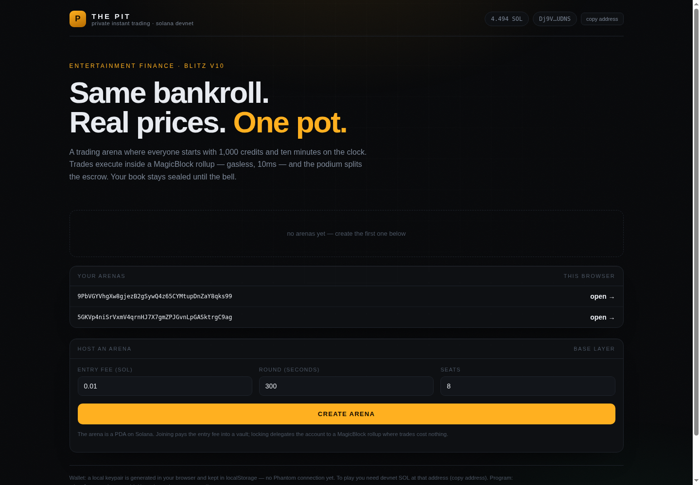

# PIT — Private Instant Trading

Ocho asientos, el mismo capital inicial, precios reales y un pozo que muerde solo.
La tabla de posiciones es pública. Tus operaciones, no.

**"Everyone sees the leaderboard. Nobody sees your book."**


**Live:** https://the-pit.zerotwolabs.xyz/ · **Código:** https://github.com/usainbluntmx/the-pit
**Demo (68 s, ES):** [`docs/demo.mp4`](docs/demo.mp4) · [`docs/demo-sin-voz.mp4`](docs/demo-sin-voz.mp4)

Estado: **devnet, 22 nov 2026** — programa desplegado, ciclo completo y las tres
piezas del stack (el carril rápido o ER, el libro sellado o Private ER, y el sorteo
verificable o VRF) comprobadas con firmas reales.

> Antes de seguir, para que no haya dudas: esto corre en **devnet**, la red de pruebas
> de Solana. Los créditos son virtuales, el SOL no vale dinero real y nadie está
> invirtiendo aquí. Es un juego con precios de verdad, no un producto financiero.

## Qué es

- Una **arena de trading con reloj**. Hasta 8 personas pagan la misma entrada, reciben
  los mismos **1,000 créditos virtuales** y compiten por un pozo común.
- Operas **LONG** (apuestas a que sube) o **SHORT** (a que baja) con **leverage de 1 a 5×**
  (el multiplicador que aplicas a tus créditos) sobre precios reales de SOL, BTC o ETH.
- Las órdenes caen al instante y **no pagan comisión**. La entrada se guarda en un pozo
  en custodia (un **escrow**) que solo el programa puede pagar.
- Cada cierto tiempo **el pozo muerde**: elige al azar a alguien que tenga una posición
  abierta y lo saca a mercado. Estar quieto, sin posición, es una defensa real.
- Al cerrar la ronda se destapan las posiciones. El podio se lleva **60/25/15** del pozo
  neto. Hay **series de 3 rondas** con puntos, y un **modo solo** contra la casa.

## Pruébalo en dos minutos

1. Abre la app y conecta Phantom, Solflare o Backpack.
2. Pide SOL de devnet con el botón de la app (no cuesta nada).
3. Crea una arena o entra a una abierta. Para jugar en grupo hacen falta **dos wallets**;
   no hay bots que se unan solos. También puedes abrir el modo solo.
4. Al bloquear la arena arranca el reloj y ya puedes operar. La mordida se dispara sola.
5. Al cerrar: `end_round` → `commit` → `settle` desde la misma UI (cerrar la ronda,
   guardarla en Solana y pagar).

Si quieres ver el flujo completo sin leer nada más, el video de 68 segundos está arriba.



---

## Cómo se juega

### 1. Entras

Conectas tu wallet y pagas la entrada. Es SOL de devnet, así que no hay riesgo real.
Tu asiento aparece en la mesa con **1,000 créditos** y tu nombre. Los demás ven que
estás dentro, pero no qué vas a hacer.

La entrada no se la queda nadie todavía: queda en el **vault**, una cuenta del programa
(una **PDA**, una cuenta que el programa controla y que nadie puede mover a mano) que
funciona como caja fuerte. De ahí sale el pozo y de ahí se paga al final.

### 2. Arranca el reloj

El creador bloquea la arena cuando ya están los que van a jugar. En ese momento la mesa
se "muda" a un carril rápido de MagicBlock y empieza la cuenta regresiva. Las rondas van
de **60 segundos a 7 días**.

### 3. Operas

Eliges LONG o SHORT, mueves el leverage y mandas la orden. No hay popup de la wallet en
cada trade y no hay comisión: la firma viaja con tu cuenta de trading, que se crea en el
navegador y se vincula una sola vez.

El tamaño de tu posición se llama **notional**: tus créditos multiplicados por el
leverage. Si entras con 1,000 y 3×, juegas 3,000. La ganancia o pérdida (**PnL**) se
calcula contra el precio de entrada. Tu pérdida máxima es tu saldo inicial (tu bankroll):
nunca quedas debiendo.

La gráfica ocupa el ancho completo y avanza con el reloj de la ronda. Cada entrada queda
clavada en su precio exacto, con una banda verde o roja que dice si esa posición va
ganando o perdiendo.

### 4. El pozo muerde

Esta es la parte que cambia el juego. No esperas a que alguien apriete un botón: el pozo
muerde solo cada **`max(15 s, duration / 8)`**. En una ronda de 180 s, cada 22 segundos.
En una de 60 s, cada 15.

La mordida elige **al azar** a un asiento que tenga posición abierta y lo cierra a
mercado. Si estás plano, no te toca. Por eso aguantar con posición es una decisión, no
un reflejo.

### 5. El campanazo

Cuando se acaba el tiempo, la ronda se cierra, las posiciones se destapan y se calcula
la equity final de cada quien (el valor de su cuenta en ese momento). El que quedó
arriba se lleva el 60 %. El segundo, 25 %. El tercero, 15 %.

Antes del reparto hay dos cosas que pueden mover el pozo:

- **Last one standing**: si al campanazo queda exactamente una posición abierta, ese
  asiento se lleva el **10 %** del pozo antes del podio.
- **Fiebre**: si tu presión llega a 100, tus órdenes salen invertidas durante 20 segundos.
  Pides long y se ejecuta short. No pierdes el juicio, pierdes el mando.

### 6. El podio y la serie

Cobras y se acabó. O sigues: una **serie** encadena 3 rondas y reparte puntos on-chain
(escritos en la blockchain, no en una base de datos privada). Al final de la serie hay
un campeón con historial, no solo una ronda suelta.

Los puntos son: **10/6/3** por podio, **+1** por cada mordida sobrevivida y **+2** por
last one standing.

### ¿Juegas solo?

Sí. Una arena de **un solo asiento** es una carrera contra el mercado. No hay pozo
compartido: la contraparte es la **casa**, una cuenta del programa con SOL de devnet.
Pones la entrada y, según tu equity final, te devuelve esto:

| Equity final | Pago |
|---|---|
| menos de 1000 | pierdes la entrada |
| 1000–1049 | 1× |
| 1050–1099 | 1.25× |
| 1100–1199 | 1.5× |
| 1200–1299 | 2× |
| 1300 o más | 3× |

Tope duro: 3× por ronda. El vault paga hasta 1×; lo que sobra sale de la casa. Si la
corrida pierde, la entrada se queda con la casa.

---

## Por qué se siente instantáneo y privado

Tres piezas hacen el trabajo. Ninguna es adorno: si quitas una, el juego no existe.

### Instantáneo: el rollup

Una blockchain normal tarda segundos y cobra comisión por transacción. Para operar eso
es insufrible. MagicBlock tiene un **Ephemeral Rollup** (ER): un carril aparte donde la
arena se ejecuta en memoria, a unos **10 ms** por orden y **sin comisión** (gasless).

Al final de la ronda, el resultado se guarda de vuelta en Solana. Ese viaje de ida y
vuelta es lo que se llama **commit** y **undelegate**: primero se escribe el estado, luego
la cuenta regresa a la capa base.

### Privado: el enclave

Si el libro de posiciones estuviera público, el juego se acaba: cualquiera copia al que
va ganando. Por eso la arena vive dentro de un **Private ER**, un validador con **TEE**
(Trusted Execution Environment), o sea un **enclave**: una caja fuerte de hardware donde
el código corre aislado. Ni quien administra el servidor puede leer lo que hay adentro.

Solo el creador y los jugadores sentados tienen permiso. Una wallet de fuera recibe
`null` al pedir la cuenta, tenga token o no. Al cerrar la ronda, el libro se destapa.

### Justo: el VRF

La mordida no la decide el servidor ni el creador. La decide un **VRF** (Verifiable
Random Function): una lotería criptográfica donde el número viene firmado y se puede
comprobar después. Nadie puede adelantarlo, repetirlo ni elegir a quién le toca.

El callback que ejecuta la mordida valida la identidad del oráculo. Si una wallet común
intenta llamarlo con bytes inventados, el programa la rechaza.

### Glosario para no perderse

| Término | Qué significa, en palabras normales |
|---|---|
| **rollup / ER** | Un carril rápido fuera de la cadena principal. Ahí las órdenes corren en memoria y luego el resultado se guarda en Solana. |
| **enclave / TEE** | Una caja fuerte de hardware. El código corre aislado y ni el dueño del servidor puede mirar adentro. |
| **VRF** | Lotería verificable. El número sale de una firma criptográfica; nadie puede manipularlo ni repetirlo. |
| **PDA** | Una cuenta que el programa crea y controla solo. No tiene llave privada, así que nadie la mueve a mano. |
| **escrow / vault** | La caja fuerte donde se guardan las entradas. Solo el programa puede sacar el dinero, y solo para pagar al podio. |
| **delegate** | Mudar una cuenta a la capa rápida para poder operar ahí. |
| **commit** | Guardar en Solana el resultado que pasó en la capa rápida. |
| **undelegate** | Regresar la cuenta a la capa base, ya con el resultado escrito. |
| **settle** | Cerrar la ronda y pagar. |
| **on-chain** | Escrito en la blockchain. Cualquiera lo puede leer y verificar; no vive en una base de datos privada. |
| **gasless** | Sin comisión por operación. |
| **PnL** | Cuánto ganas o pierdes con una posición. |
| **notional** | El tamaño de tu posición: tus créditos por el leverage. |
| **devnet** | La red de pruebas de Solana. El SOL ahí no vale dinero real. |
| **crank** | Un empujón que cualquiera puede dar para que el reloj del juego avance. |
| **rent** | Un depósito que la red te cobra por tener una cuenta viva y te devuelve al cerrarla. |
| **rake** | La comisión de la casa, definida al crear la arena. |
| **CPI** | Una llamada de un programa a otro programa dentro de la misma transacción. |
| **IDL** | La lista pública de instrucciones del programa, para que otros lo puedan llamar. |

---

## Para quien quiere el detalle

Todo lo de arriba está sostenido por esto. Aquí no hay maqueta: son cuentas, posiciones
de bytes, instrucciones y pruebas corridas en devnet.

### El stack de MagicBlock y el ciclo

| Necesidad del producto | Pieza del stack | Dónde | Estado |
|---|---|---|---|
| Cada trade cae en el instante, sin fee (sin comisión) | **Ephemeral Rollup** (10 ms, gasless) | `open_position`, `close_position` | ✓ |
| El libro de posiciones no es público | **Private ER** (TEE) | `init_permission`, `set_privacy` | ✓ |
| Nadie puede elegir el resultado | **VRF** | `request_shock`, `shock_callback` | ✓ |
| Precio justo y fresco al momento de operar | **Pricing Oracle** (Pyth Lazer) | `read_price` | ✓ |

El oráculo **solo existe en el ER**: en la capa base los feeds `SOLUSD`/`ETHUSD`
están delegados (owner = Delegation Program) y no publican. Eso hace que el ER no
sea un adorno: sin rollup no hay juego.

```
BASE   create_arena ──▶ join_arena ×N ──▶ lock_arena
BASE   delegate_arena            (owner pasa al Delegation Program)
ER     open_position / close_position      (oracle + gasless)
ER     end_round ──▶ commit_round          (commit + undelegate)
BASE   settle                              (el escrow paga al podio)
```

Regla de capa, sin excepciones: `delegate` va a base; todo lo que toca la arena
delegada va al `fqdn` (la dirección del nodo) que devuelve `getDelegationStatus`;
`commit`/`undelegate` van al ER.

### Modelo de estado

Una sola cuenta delegada (`Arena`, 982 bytes) contiene hasta **8** `Seat`. Se delega
un account, no ocho, y el estado privado es exactamente ese: el libro completo.

```
Seat {
  player, bankroll, realized, notional, entry_price, trades, side,
  bites, streak, pressure, mad_until
}
```

- `bankroll` = 1,000.0 créditos virtuales por asiento (fixed 1e9)
- `notional` = equity × leverage, leverage 1..=5
- PnL = `notional × (precio_salida − precio_entrada) / precio_entrada`, con signo
- Pérdida tope = bankroll (la equity nunca baja de 0)
- Ranking por equity final; el podio se lleva 60/25/15 del pozo neto

La `Arena` guarda además `is_private`, `shock_seat`, `shock_count`, `last_shock_ts`,
`series`, `round_no`, `lst_winner`, `lst_bonus` y `series_recorded`: todo lo que un
cliente necesita para reconstruir el juego sin un registro off-chain.

Cada `Series` (724 bytes) lleva el nonce, el calendario y `standings[8]` con
`points`, `rounds`, `podiums`, `bites` y `survived`.

### Precio

`PriceUpdateV3` (Borsh, el formato con el que se serializa la cuenta), con las posiciones
de bytes (offsets) verificadas contra la cuenta viva en devnet:

```
73..81   price          i64 LE
89..93   exponent       i32 LE   (magnitud de decimales)
93..101  publish_time   i64 LE   (unix seconds)
```

Se valida: dirección == `arena.feed`, longitud, precio > 0, `publish_time`
dentro de 120 s. El exponente se normaliza a 1e9 sin importar el signo.

Feeds devnet (PDA `["price_feed","pyth-lazer",<id>]` del programa `PriCems…`):

| Par | id | Cuenta |
|---|---|---|
| SOLUSD | 6 | `ENYwebBThHzmzwPLAQvCucUTsjyfBSZdD9ViXksS4jPu` |
| BTCUSD | 1 | `71wtTRDY8Gxgw56bXFt2oc6qeAbTxzStdNiC425Z51sr` |
| ETHUSD | 2 | `5vaYr1hpv8yrSpu8w3K95x22byYxUJCCNCSYJtqVWPvG` |

### Instrucciones (18 de juego + `process_undelegation` del SDK)

| IX | Capa | Quién |
|---|---|---|
| `create_arena(nonce, entry_fee, duration_secs, max_players, rake_bps, feed)` | base | cualquiera |
| `join_arena(nonce)` | base | jugador (paga entry fee al vault) |
| `lock_arena(nonce)` | base | creador |
| `delegate_arena(nonce)` | base | cualquiera paga |
| `open_position(nonce, side, leverage)` | ER | jugador |
| `close_position(nonce)` | ER | jugador |
| `end_round(nonce)` | ER | cualquiera, tras `end_at` |
| `commit_round(nonce)` | ER | cualquiera |
| `settle(nonce)` | base | cualquiera, permissionless e idempotente (2+ asientos) |
| `settle_solo(nonce)` | base | cualquiera, permissionless e idempotente (1 asiento, paga la casa) |
| `init_permission` | ER | arena (paga su propio permiso TEE) |
| `set_privacy(bool)` | ER | creador o jugador |
| `close_permission` | ER | creador o jugador (devuelve el rent) |
| `request_shock(nonce)` | TEE | cualquiera, con cooldown cumplido |
| `shock_callback` | TEE | solo el oráculo VRF |
| `create_series(nonce, max_rounds)` | base | cualquiera |
| `bind_series(nonce, series_key)` | base | creador de la arena y de la serie |
| `record_round(nonce, series_key)` | base | cualquiera, con la ronda ya liquidada |

Permissionless quiere decir que cualquiera puede llamarla, sin permiso. Idempotente quiere
decir que repetirla no cambia el resultado.

### Private ER (TEE)

La arena se delega al validador TEE (`MTEWGuqxUpYZGFJQcp8tLN7x5v9BSeoFHYWQQ3n3xzo`), no a un ER público.
Ahí se crea su `EphemeralPermission` y se sella o se abre.

```
delegate_arena(validator = TEE)   → base
init_permission                   → ER   (payer = la PDA de la arena, idempotente)
set_privacy(true|false)           → ER   (reconstruye la lista de miembros completa)
close_permission                  → ER   (devuelve el rent a la arena)
```

- **Miembros del sello**: el creador + cada jugador sentado, con `TX_LOGS | TX_MESSAGE | TX_BALANCES`.
  Cualquier otra wallet queda rechazada en el ingress del TEE, incluso con un token válido.
- **Pre-fonding**: `create_arena` transfiere a la arena el rent de `EphemeralPermission::size_of(17)`,
  porque el permiso lo paga la propia PDA y sus lamports (las fracciones mínimas de SOL)
  viajan con ella al rollup.
- **Token**: `getAuthToken(TEE, wallet, firmarChallenge)` → `https://devnet-tee.magicblock.app?token=…`.
  Es por wallet: cada jugador firma el suyo. La URL tokenizada es una credencial, no se loguea.
- **Estado visible**: el flag `is_private` se espeja en la cuenta `Arena` para que cualquier cliente
  lo lea sin depender de un endpoint.

#### Prueba ejecutada (devnet, 2026-11-20)

| Paso | Resultado |
|---|---|
| `verifyTeeRpcIntegrity` | pasa (prueba de hardware del enclave verificada; sin excepción) |
| `init_permission` + `set_privacy(true)` | ✓ |
| Trade de un miembro con el pozo sellado | ✓ |
| Wallet fuera de la lista, **con token válido**, leyendo la arena | **`null`** |
| Tras `set_privacy(false)`, la misma lectura | **devuelve la cuenta** |

### VRF

`request_shock` pide al oráculo un asiento al azar; el callback autenticado lo liquida a mercado.

```
request_shock      → TEE   CPI al VRF program, encola el request (queue delegada)
shock_callback     → TEE   lo llama el oráculo, #[vrf_callback] valida la identidad
```

- El `caller_seed` no lo controla el usuario: se compone de la pubkey de la arena + el reloj.
- `shock_seat` es el guard de idempotencia: un callback repetido ve el valor puesto y no toca nada.
- El índice se clampa con `.min(count - 1)` porque la semántica del rango de
  `random_u8_with_range` no está documentada.

#### Prueba ejecutada (devnet, 2026-11-20)

| Paso | Resultado |
|---|---|
| `request_shock` en el TEE con la queue delegada | ✓ |
| Callback del oráculo | **seat 2 liquidado**, posición plana y PnL realizado |
| Wallet llamando `shock_callback` directamente con 32 bytes inventados | **rechazado** |

### La mordida (game loop)

El pozo no espera a que alguien apriete un botón: muerde solo.

```
cooldown = max(15s, duration / 8)      // 180s -> 22s, 240s -> 30s, 60s -> 15s
request_shock   (crank, permissionless) // exige cooldown cumplido y >=1 posición abierta
shock_callback  (oráculo)               // elige SOLO entre asientos con posición abierta
```

- **Solo muerde a quien está dentro del mercado.** Estar plano es una defensa real, y eso
  convierte cada operación en una decisión de aguante, no de matemática.
- El cooldown lo impone el programa, no el cliente: cualquiera puede hacer crank y nadie
  puede spamear.
- El `callback_args` lleva el **epoch** (el contador interno de mordidas, `shock_count`).
  Un callback viejo o reordenado se descarta solo, así que nadie recibe dos mordidas
  por la misma petición.
- La UI hace el crank cuando vence el plazo, así que la partida avanza sin un bot externo.

#### Verificado en devnet (2026-11-20)

Arena `AcyvychbYfbmFTx1bFViVEEWvAWyWDDxrXYjH3ZaX2zH`, 5 asientos, ronda de 180s:

| # | Mordida | Resultado |
|---|---|---|
| 1 | COBRA-PRIME | plano a mercado |
| 2 | FALCON-ZERO | plano a mercado |
| 3 | JACKAL-NINE | plano a mercado |

Las tres las disparó la UI sola, con la cola delegada y el callback autenticado del oráculo.

### Progresión: racha, bono y serie

Tres capas de juego encima de la ronda, todas on-chain.

#### 1. Racha de supervivencia

Cada asiento guarda `bites` (veces que el pozo lo sacó) y `streak` (mordidas seguidas que
sobrevivió **estando dentro del mercado**). Estar plano no suma racha: no estabas en riesgo.
La racha se ve en el leaderboard ("2 survived") y **paga puntos** al registrar la ronda.

#### 2. Last one standing

Si al campanazo queda exactamente una posición abierta, ese asiento se lleva el **10 % del
pozo** antes del reparto del podio. El pozo se reparte igual: `net = pot - rake - bono`.

Para que ese bono sea alcanzable, el pozo **deja de morder** antes del final: la última
mordida tiene que caber entera (`now + cooldown <= end_at`), así que los últimos segundos
son una ventana limpia para aguantar la posición.

El bono viaja como `remaining_accounts[winners]` después del podio.

#### 3. Serie de 3 rondas

```
create_series(nonce, 3)  ->  PDA ["series", nonce] con standings
bind_series(nonce, serie) ->  numera la ronda (1..3)
record_round(nonce, serie) ->  suma puntos, permissionless e idempotente
```

Puntos: **podio 10/6/3 + 1 por mordida sobrevivida + 2 por last-one-standing**.

`record_round` exige `status == Closed` (ya pagado), que la arena pertenezca a la serie y que
`series_recorded` esté en false. Una ronda cuenta una sola vez.

#### Verificado en devnet (2026-11-20)

Serie `season-01`, tres rondas de 60s, 3 jugadores:

```
[round 1] settled · podium 3 · lst 5RMTj2 (+0.003 SOL) · series rounds 1/3
[round 2] settled · podium 3 · lst —              · series rounds 2/3
[round 3] settled · podium 3 · lst —              · series rounds 3/3
=== SERIES FINAL ===
 HWCX7V  23 pts  podiums 3  rounds 3
 5RMTj2  18 pts  podiums 3  rounds 3
 HHaJUe  18 pts  podiums 3  rounds 3
```

Y una ronda jugada desde la UI, con mordidas reales:

```
 round 1/3 · Dj9Vvh  4 pts | podiums 0 | survived 2 | bites 0   <- 2 racha + 2 bono
        · 4kp5RT 10 pts | podiums 1 | survived 0 | bites 1
```

### Modo solo: el mercado como contraparte

Una arena con **un solo asiento** (`max_players = 1`) es una corrida contra el mercado.
No hay pozo compartido: la contraparte es la **casa**, una PDA del programa
(`PDA(["house"])`) fondeada con SOL de devnet.

- El jugador paga la entrada al vault, igual que en multijugador.
- Al campanazo, `end_round` marca la equity final y `settle_solo` aplica la tabla:
  `< 1000` pierde la entrada · `1000–1049` devuelve 1× · `1050–1099` 1.25× ·
  `1100–1199` 1.5× · `1200–1299` 2× · `≥1300` 3×.
- El vault paga hasta 1×; lo que exceda sale de la casa. Si la corrida pierde,
  la entrada se queda en la casa. Tope duro: 3× por ronda.
- `last one standing` no aplica en solo (el único asiento no puede llevarse un 10 %
  de su propia entrada), y `settle` rechaza arenas de un asiento para que nadie
  cobre por la puerta equivocada.

Verificado en LiteSVM (`cargo test -p the-pit --test solo_settle`) con las tres ramas:
victoria (vault + casa), derrota (entrada a la casa) y empate (vault devuelve la entrada),
más el rechazo de `settle` en una arena solo. Y en devnet con `scripts/e2e-solo.ts`:
corrida de 60 s (`1×`, jugador +0.01 SOL) y de 120 s (`0×`, casa +0.01 SOL).

Casa en devnet: `7VgmHJJxBq4UxpfW3iy8KzUP6vRTu7RDWAQz2d3Bg8hp`.

### Fiebre: cuando pierdes el control de tus órdenes

Cada asiento lleva una **presión** (0..100). Sube cuando el pozo te saca (+40) y cuando
cierras en pérdida más de 20 créditos (+25); baja cuando cierras en verde (−30).

Al llegar a 100 el asiento entra en **fiebre durante 20 s**:

- **Sus órdenes salen invertidas.** Pide long, se ejecuta short. Ese es el castigo real:
  no pierde el juicio, pierde el mando. Nada permanente: la fiebre caduca sola.
- La UI lo muestra glitcheado: nombre con aberración cromática, línea de delirio y la
  barra de presión al rojo.

La línea de delirio la genera el juego con una semilla (`seat + mad_until`), no el modelo.
Es reproducible: la misma fiebre produce el mismo texto.

```
close en pérdida  -> pressure += 25
mordida del pozo  -> pressure += 40
close en verde    -> pressure -= 30
pressure >= 100   -> mad_until = now + 20s, pressure = 40
open_position     -> si now < mad_until, side = -side
```

Para agentes: `mad_until` y `pressure` van en la cuenta `Arena`, así que un framework de
agentes puede leerlas y decidir si sigue operando, se retira o entra en personaje. Lo que
el juego garantiza es el cuerpo (órdenes invertidas); lo que no puede garantizar es la
cabeza de un LLM ajeno.

#### Verificado en devnet (2026-11-20)

Arena de 2 asientos, 300 s, los dos dentro del mercado:

```
[shock #1] Dj9V:0  9Br4:40
[shock #2] Dj9V:40 9Br4:40
[shock #3] Dj9V:40 9Br4:80
[shock #4] Dj9V:40 9Br4:40   <- 9Br4 llegó a 100 y entró en fiebre
 1 9Br4 bites=3 press=40 mad=true
```

### La app (frontend)

```
/       landing (pitch, mecánica, stack, CTA)
/play   la app: lobby, series y arenas
```

`web/` — Next.js 15 + React 19. Se conecta directo a las wallets inyectadas
(Phantom, Solflare, Backpack) sin `wallet-adapter`: el jugador firma con su propia
llave, que nunca sale de la extensión. Al conectar, la UI ofrece un airdrop (SOL de
prueba gratis) para pagar la entrada.

Qué hace:

- **Wallet**: conecta la extensión del jugador (Phantom, Solflare, Backpack) y firma
  cada transacción con ella; reconecta solo al recargar (`onlyIfTrusted`). La llave
  nunca pasa por la app. Incluye botón de airdrop para devnet.

- **Trading account**: al conectar, la app puede generar un keypair (un par de llaves)
  desechable en el navegador, pedirle a la wallet principal **una sola firma** para
  vincularlo y fondearlo con 0.05 SOL desde `/api/faucet`. Desde ahí las órdenes las firma la
  trading account, sin un popup por trade. La UI permite volver a la wallet principal
  y retirar el saldo. Es devnet: la llave vive en `localStorage`; en mainnet (la red real) esto se
  reemplaza por una session key on-chain revocable.

- **Lobby**: lista todas las arenas, incluidas las que están delegadas. Una cuenta
  delegada desaparece del `getProgramAccounts` de la capa base (su owner pasa a ser
  el Delegation Program), así que la lista se construye fusionando base + los tres
  rollups de devnet.

- **Arena en vivo**: el pozo, el reloj, el precio del feed leído dentro del rollup y la
  tabla de posiciones con las de los demás tapadas hasta el cierre.

- **Next move**: un panel según el estado de la ronda dice qué hacer ahora (unirse,
  invitar, bloquear, operar, liquidar), con enlace de invitación `?arena=<pubkey>`
  que abre la misma mesa al invitado.

- **Guía interactiva**: tour de 4 pasos en el lobby y de 4–5 en la arena (según el
  estado) que resalta el elemento, explica qué hacer y por qué, con `?guide` para
  repetirlo. Se guarda en `localStorage` para no molestar dos veces.

- **Movimiento**: transición entre rutas, entrada escalonada de tarjetas y paneles,
  reveals al hacer scroll en la landing y feedback en botones; todo respeta
  `prefers-reduced-motion`.

- **Host an arena**: entrada, duración, asientos y **mercado** (SOL / BTC / ETH, cada
  uno con su feed de Pyth Lazer). El feed queda grabado en la cuenta y define el
  precio de toda la ronda.

- **Ticket**: LONG / SHORT con leverage 1–5×, ejecutado en el ER (gasless), con la
  barra de presión y la línea de delirio cuando el asiento está en fiebre.

- **Ciclo completo desde la UI**: join → lock → delegate → trade → end round →
  commit & undelegate → settle, más el crank de la mordida cuando vence el cooldown.

- **Reveal**: al cerrar la ronda se destapan los PnL y el podio, y el escrow paga.

```bash
cd web
npm install
npm run build && npm run start     # http://localhost:3000
```

Bots para llenar la arena en la demo (keypairs deterministas por `SEED`):

```bash
ARENA=<pubkey> BOTS=3 SEED=7 npx tsx scripts/bots.ts join
ARENA=<pubkey> BOTS=3 SEED=7 npx tsx scripts/bots.ts trade
```

Arena suelta con un mercado concreto, para probar feeds sin la UI:

```bash
npx tsx scripts/create-arena.ts BTC     # SOL | BTC | ETH
```

Capturas en `docs/screens/` (landing, lobby y serie). Las de la arena en vivo se rehacen
cuando haya una ronda con posiciones abiertas: el gráfico del feed cambió y las viejas
quedaron desactualizadas.

### Toolchain

Versiones clavadas a lo que documenta MagicBlock y usan sus ejemplos oficiales:

- Solana CLI 3.1.9
- Rust 1.89.0
- Anchor 1.0.2 (`anchor-syn` pinneado a 1.0.2 — un caret resuelve 1.2.x y rompe el build)
- `ephemeral-rollups-sdk` 0.16.2 (`features = ["anchor", "access-control", "vrf"]`)

### Build, test y deploy

```bash
anchor build
cargo test -p the-pit            # unitarios de precio y PnL
npx tsx scripts/e2e.ts           # runbook completo en devnet
```

Deploy en devnet. El RPC público `api.devnet.solana.com` limita las peticiones (error 429) y el deploy de un
programa de ~545 KB muere con `Data writes to account failed: Max retries exceeded`. Usa el
proxy de MagicBlock:

```bash
solana config set --url https://rpc.magicblock.app/devnet
anchor program deploy --provider.cluster https://rpc.magicblock.app/devnet
```

Si un deploy falla a medias, el buffer queda huérfano con ~1.9 SOL dentro:

```bash
solana program show --buffers
solana program close --buffers
```

#### Estado del deploy

- Program ID: `4iVtfWTrVo4iUAeTBVhhjkDr9kGK4dTD95vKM8c6dbar` (devnet)
- Upgrade authority: `Dj9VvhrDUMtumbkiY9dZPZQczmJHAwDvrdLY6kHoUDNS` (`~/.config/solana/id.json`)
- Binario: 545,336 bytes, 19 instrucciones en el IDL
- Arena verificada más reciente: `FCjiCWgQi3ZVpGEJa2SmtYyc4a3YxwZeEvM9ei1cFhgW`
  — 3 jugadores, pot 0.03 SOL, pagos 60/25/15, status `closed` (20 nov, 08:14 UTC).
- Primera corrida completa del runbook: `EwR4JaXswgkLaCPVpby25buXhRgDRLxn76S15AjY1Njp`
  — 3 jugadores, pot 0.03 SOL, podio 1001.59 / 1000.62 / 998.22 (20 nov, 01:57 UTC).
- Runbook completo probado el 2026-11-20: create → join ×3 → lock → delegate → open ×3 → close ×2 →
  end_round → commit+undelegate → settle, con ownership verificado en base, router y ER en cada transición.

### Trampas propias del deploy (ya resueltas en el código)

- El `trader` **no** puede llevar `#[account(mut)]` en el contexto de ER: una wallet de la capa base no está
  delegada y el rollup rechaza cuentas writable no delegadas con `InvalidWritableAccount`.
- `settle` necesita los ganadores en `remaining_accounts`, porque el vault firma un CPI de transferencia y un
  CPI solo puede tocar cuentas que recibe.
- Al crecer el binario hay que `solana program extend <ID> <BYTES>` antes de upgradear, o el loader responde
  `ProgramData account not large enough`.
- **Stack overflow por cuenta grande**: con `Arena` por encima de ~1.5 KB, `Account<Arena>` inline revienta el
  frame (`Access violation in stack frame 5`) en los contextos con CPI pesado. Solución: `Box<Account<'info, Arena>>`
  en **todos** los contextos.
- **Anchor 1.0.2**: dos argumentos `String` en `#[instruction(...)]` hacen que el programa muera con
  `Access violation reading 8 bytes at address 0x0` al validar las seeds. Por eso `bind_series` y `record_round`
  reciben la clave de la serie como `Pubkey`, no su nonce.
- La queue del VRF tiene que ir `mut` en el contexto o el CPI falla con `PrivilegeEscalation`.
- `getPermissionStatus()` del SDK 0.16.2 pega a `GET /permission` y en el TEE de devnet responde
  **404 `{"error":"Not found: GET /permission"}`**. Por eso el estado se lee del flag `is_private` en la
  cuenta, no de ese helper.

---

## Estado del proyecto

Hecho y verificado con firmas en devnet:

- [x] Programa completo (19 instrucciones en el IDL) y build SBF (el binario que corre en Solana)
- [x] Cliente TS de doble conexión + runbook (la corrida completa, paso a paso) en devnet (`scripts/e2e.ts`)
- [x] Deploy devnet y ciclo de punta a punta
- [x] Private ER (TEE) — pozo sellado, lectura `null` para wallets fuera de la lista
- [x] VRF — mordida autenticada, callback falsificado rechazado
- [x] Mordida automática, last-one-standing, serie de 3 y fiebre
- [x] Frontend (landing + lobby, arena en vivo, ticket, reveal, controles de ciclo completo)
- [x] Landing y navegación (`/` ↔ `/play`)
- [x] i18n (interfaz en español e inglés) con switch persistente en landing, lobby y arena
- [x] Modo solo contra el mercado (`settle_solo` + casa PDA, 4 tests en LiteSVM)
- [x] Trading account con faucet propio (grifo de SOL de prueba, `/api/faucet`, firma de vinculación + rate limit)
- [x] Gráfica del feed a pantalla completa: eje con el reloj de la ronda, línea en vivo y el
  punto exacto de cada entrada LONG/SHORT con su precio, más la banda de ganancia/pérdida
  contra la entrada vigente
- [x] Modo solo visible desde el lobby y la landing: tarjetas de modo y enlace directo
  `/play?mode=solo` (antes solo existía dentro de un desplegable)

Pruebas de devnet que puedes ir a mirar:

- **Arena liquidada con podio real:** `FCjiCWgQi3ZVpGEJa2SmtYyc4a3YxwZeEvM9ei1cFhgW`
  (3 asientos, pozo 0.03 SOL, pagos 60/25/15, estado `closed`)
- **Arena en vivo / abierta:** `G6Qnx7x14BZkT1b7Lbzkge5n1EkazHtzxHzJiurbap2B`
- **Serie verificada:** `season-01`, 3 rondas de 60 s, puntos on-chain (23 / 18 / 18)
- **Modo solo verificado:** arena `GnwU16uzvtZrzmk2dwJsSyi9foNznE8Rc5RPFnytCWUr`
  (1 asiento, equity 1002.12 → pago 1×, jugador +0.01 SOL) y una corrida de 120 s
  (equity 997.22 → 0×, la casa retuvo la entrada)
- **Tests deterministas:** `cargo test -p the-pit` — 6 unitarios + `join_flow` +
  `onchain_layout` + 4 de `settle_solo` (victoria, derrota, empate y rechazo de `settle`)
- **Trading account:** keypair generado en el navegador, vinculado con una firma de la
  wallet principal y fondeado con 0.05 SOL por `/api/faucet` (rate limit por wallet e IP)

Publicación:

- [x] Repo git + publicación en GitHub
- [x] Deploy público del web — https://the-pit.zerotwolabs.xyz/ (Dokploy, auto-deploy en cada push a `main`)
- [x] Video demo corto y proof of work listos para compartir

## Equipo

Ricardo Fuentes - Zero Two Labs (Mexico)
